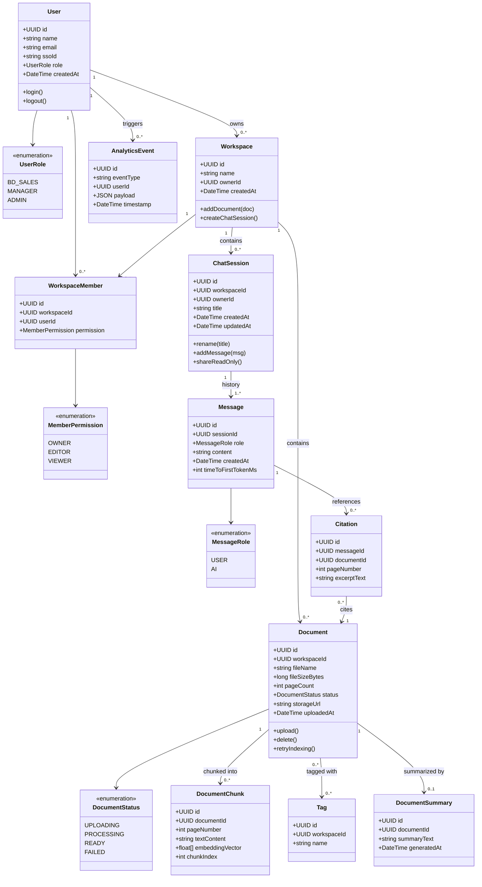

# Class Diagram: DocuChat AI

| | |
|---|---|
| **Tài liệu** | Domain / Class Diagram |
| **Dự án** | DocuChat AI |
| **Nguồn** | Dựa trên `docs/02-PRD/PRD-DocuChat-AI.md` (Epic 1, 2, 4, 5) |

---

## 1. Mermaid Class Diagram

## 2. Giải thích các lớp chính

| Lớp | Vai trò | Liên kết PRD |
|---|---|---|
| `User` | Nhân sự đăng nhập qua SSO nội bộ (Linh, Quang, Admin) | §2.1, §5.1 |
| `Workspace` | Không gian làm việc chứa tài liệu + phiên chat của một nhóm/dự án | §4.1 |
| `Document` | Đại diện 1 file PDF đã upload, có trạng thái xử lý rõ ràng | Epic 1 |
| `DocumentChunk` | Đơn vị văn bản đã được embedding để phục vụ retrieval (RAG) | Epic 2 (kỹ thuật) |
| `Tag` | Gắn nhãn tài liệu theo dự án (P2) | Story 1.5 |
| `ChatSession` | Một phiên hội thoại hỏi-đáp, có thể đổi tên/chia sẻ | Epic 4, 5 |
| `Message` | Tin nhắn trong phiên chat (người dùng hoặc AI) | Epic 2 |
| `Citation` | Trích dẫn nguồn gắn với 1 Message, trỏ tới Document + trang | Story 2.2, 2.3 |
| `DocumentSummary` | Tóm tắt tự động sau khi upload (P1) | Epic 3 |
| `AnalyticsEvent` | Sự kiện tracking phục vụ đo OKR | §5.2 |

## 3. Ghi chú thiết kế

- `Citation` tách khỏi `DocumentChunk` vì một câu trả lời có thể trích dẫn nhiều đoạn nhưng chỉ cần lưu excerpt hiển thị cho người dùng, không cần toàn bộ embedding.
- `DocumentStatus.FAILED` cần lưu kèm lý do lỗi (xem AC Story 1.3) — có thể mở rộng thêm field `failureReason` khi sang SADD/DB schema.
- `WorkspaceMember` + `MemberPermission` là phần chuẩn bị cho Epic 5 (P2 — phân quyền), chưa bắt buộc cho P0 MVP nhưng đưa vào model sớm để tránh phải migrate lớn sau này.

---

➡️ Tiếp theo: [Use Case](../04-UseCase/UseCase-DocuChat-AI.md)
