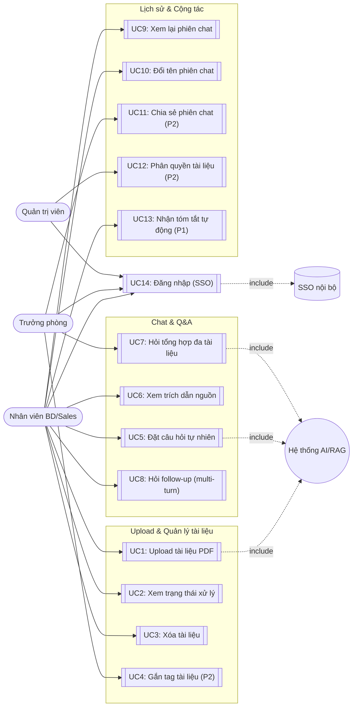

# Use Case: DocuChat AI

| | |
|---|---|
| **Tài liệu** | Use Case Diagram & Specifications |
| **Dự án** | DocuChat AI |
| **Nguồn** | `docs/02-PRD/PRD-DocuChat-AI.md`, `docs/03-ClassDiagram/ClassDiagram-DocuChat-AI.md` |

---

## 1. Actors

| Actor | Mô tả |
|---|---|
| **Nhân viên BD/Sales (Linh)** | Actor chính, thực hiện hầu hết use case upload & chat |
| **Trưởng phòng (Quang)** | Dùng chung các use case với Linh, thêm use case tổng hợp đa tài liệu & chia sẻ |
| **Quản trị viên (Admin)** | Quản lý phân quyền tài liệu (P2) |
| **Hệ thống AI/RAG (system actor)** | Thực hiện indexing, retrieval, sinh câu trả lời kèm trích dẫn |
| **Hệ thống SSO nội bộ (external system)** | Xác thực đăng nhập |

## 2. Use Case Diagram (Mermaid)

## 3. Đặc tả Use Case chi tiết (P0)

### UC1 — Upload tài liệu PDF
- **Actor chính**: Nhân viên BD/Sales
- **Điều kiện tiên quyết**: Đã đăng nhập, đang ở workspace
- **Luồng chính**:
  1. Người dùng kéo-thả hoặc chọn 1/nhiều file PDF (≤ 50MB)
  2. Hệ thống validate định dạng & dung lượng client-side
  3. Hệ thống upload file lên storage, hiển thị progress bar
  4. Hệ thống chuyển trạng thái Document sang `PROCESSING` và kích hoạt UC "Indexing" (hệ thống AI)
- **Luồng thay thế**:
  - 2a. File không phải PDF hoặc > 50MB → từ chối, hiển thị lỗi, không gửi lên server
  - 4a. Indexing thất bại (ví dụ scan ảnh không text layer) → Document chuyển `FAILED` kèm lý do cụ thể
- **Hậu điều kiện**: Document ở trạng thái `READY` hoặc `FAILED`
- **Liên kết**: PRD Story 1.1, 1.3; AC tương ứng

### UC2 — Xem trạng thái xử lý tài liệu
- **Actor chính**: Nhân viên BD/Sales
- **Luồng chính**: Người dùng xem danh sách tài liệu ở cột trái, mỗi item hiển thị trạng thái (`Đang tải lên` / `Đang xử lý` / `Sẵn sàng` / `Lỗi`)
- **Quy tắc nghiệp vụ**: Chat input bị disable cho tới khi có ít nhất 1 tài liệu `READY`
- **Liên kết**: PRD Story 1.3

### UC5 — Đặt câu hỏi tự nhiên
- **Actor chính**: Nhân viên BD/Sales; **Actor phụ**: Hệ thống AI/RAG
- **Điều kiện tiên quyết**: Có ≥ 1 Document ở trạng thái `READY`
- **Luồng chính**:
  1. Người dùng nhập câu hỏi (tiếng Việt/Anh) vào ô chat
  2. Hệ thống gửi câu hỏi + ngữ cảnh workspace tới AI/RAG
  3. AI truy xuất các `DocumentChunk` liên quan, sinh câu trả lời dạng streaming
  4. Hệ thống gắn kèm ≥ 1 `Citation` (file + trang) vào câu trả lời
- **Luồng thay thế**:
  - 3a. Không tìm thấy nội dung liên quan → AI trả lời "Tôi không tìm thấy thông tin này trong các tài liệu đã cung cấp", không suy diễn
  - 2a. Mất kết nối giữa chừng → giữ nguyên input đã gõ, hiển thị banner reconnect
- **Hậu điều kiện**: Message (AI) + Citation được lưu vào ChatSession
- **Liên kết**: PRD Story 2.1, 2.2, 2.4

### UC6 — Xem trích dẫn nguồn
- **Actor chính**: Nhân viên BD/Sales
- **Điều kiện tiên quyết**: Đã nhận được câu trả lời AI kèm Citation
- **Luồng chính**:
  1. Người dùng click chip trích dẫn `[Tên_file.pdf, trang X]`
  2. Hệ thống mở panel/overlay PDF viewer tại đúng trang X
  3. Hệ thống highlight đoạn văn bản nguồn tương ứng
- **Hậu điều kiện**: Người dùng xác minh được nguồn, không rời khỏi khung chat
- **Liên kết**: PRD Story 2.3

### UC7 — Hỏi tổng hợp đa tài liệu
- **Actor chính**: Trưởng phòng (Quang) / Nhân viên BD
- **Điều kiện tiên quyết**: ≥ 2 Document ở trạng thái `READY`
- **Luồng chính**: Giống UC5, nhưng AI truy xuất chunk từ nhiều Document, trả lời có phân biệt rõ nguồn nào nói gì
- **Liên kết**: PRD Story 2.6

## 4. Đặc tả Use Case (P1/P2 — tham khảo)

| Use Case | Actor | Tóm tắt | Priority |
|---|---|---|---|
| UC3 — Xóa tài liệu | Linh | Xóa Document khỏi workspace và index | P1 |
| UC4 — Gắn tag tài liệu | Quang | Gắn `Tag` cho Document theo dự án | P2 |
| UC8 — Hỏi follow-up | Linh | Hỏi tiếp trong cùng ngữ cảnh ChatSession (multi-turn) | P1 |
| UC9 — Xem lại phiên chat | Linh | Mở lại ChatSession cũ kèm lịch sử Message | P1 |
| UC10 — Đổi tên phiên chat | Linh | Rename `ChatSession.title` | P2 |
| UC11 — Chia sẻ phiên chat | Quang | Tạo link read-only cho ChatSession | P2 |
| UC12 — Phân quyền tài liệu | Admin | Gán `MemberPermission` theo Document/Workspace | P2 |
| UC13 — Nhận tóm tắt tự động | Linh | Hệ thống sinh `DocumentSummary` ngay sau khi Document `READY` | P1 |

---

➡️ Tiếp theo: [SADD](../05-SADD/SADD-DocuChat-AI.md)
