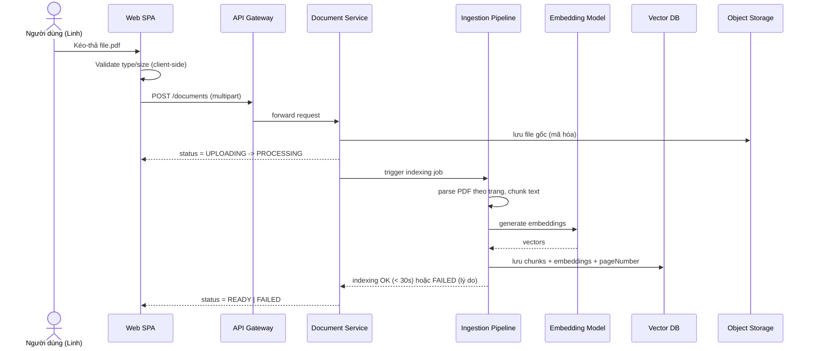
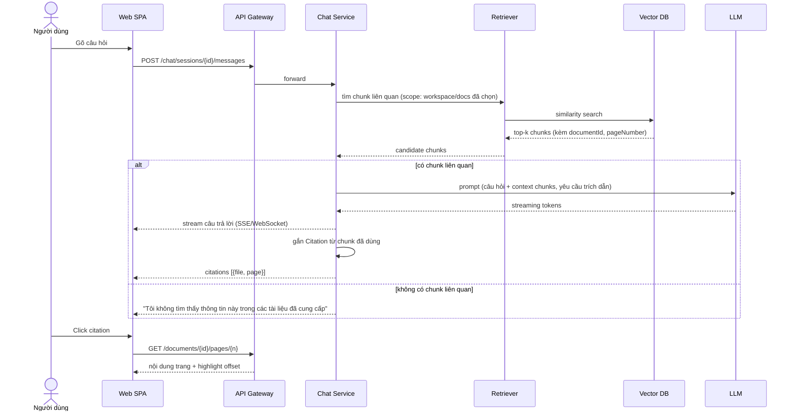

# SADD: System Architecture & Design Document — DocuChat AI

| | |
|---|---|
| **Tài liệu** | System Architecture & Design Document (SADD) |
| **Dự án** | DocuChat AI |
| **Nguồn** | PRD §1.2 (OKR/NFR), §5.1 (Launch Gate), Class Diagram, Use Case |

---

## 1. Mục tiêu kiến trúc

Kiến trúc phải đáp ứng trực tiếp các ngưỡng hiệu năng/bảo mật trong PRD:

| Yêu cầu | Ngưỡng | Nguồn |
|---|---|---|
| Thời gian indexing 1 PDF 20 trang | < 30s | O2-KR1 |
| Time-to-first-token (TTFT) | < 3s | O2-KR2 |
| Tỷ lệ upload/xử lý thất bại | < 5% | O2-KR3 |
| Mã hóa dữ liệu | at-rest + in-transit | §5.1 Security |
| Không train lại model bên thứ ba bằng tài liệu người dùng | Bắt buộc | §5.1 Security |
| Access control | SSO tài khoản công ty | §5.1 Security |

## 2. Kiến trúc tổng quan (High-level Architecture)

```mermaid
flowchart TB
    subgraph Client
        SPA["Web SPA (React)"]
    end

    subgraph Edge
        GW["API Gateway / BFF"]
        AUTH["Auth Service (OIDC/SSO nội bộ)"]
    end

    subgraph Core Services
        DOCSVC["Document Service\n(upload, metadata, status)"]
        INGEST["Ingestion Pipeline\n(parse PDF, chunk, embed)"]
        CHATSVC["Chat Service\n(orchestrate RAG, streaming)"]
        RETRIEVER["Retriever\n(similarity search)"]
    end

    subgraph Data Stores
        OBJSTORE[("Object Storage\n(PDF gốc, mã hóa at-rest)")]
        VECTORDB[("Vector DB\n(embeddings + metadata trang)")]
        RELDB[("Relational DB\n(User, Workspace, ChatSession, Message, Citation)")]
    end

    subgraph AI Provider
        EMBED["Embedding Model\n(nội bộ/được duyệt, no-train-on-input)"]
        LLM["LLM\n(nội bộ/được duyệt, no-train-on-input)"]
    end

    ANALYTICS["Analytics Pipeline\n(event tracking §5.2 PRD)"]

    SPA -- HTTPS/TLS --> GW
    GW --> AUTH
    GW --> DOCSVC
    GW --> CHATSVC

    DOCSVC --> OBJSTORE
    DOCSVC --> RELDB
    DOCSVC --> INGEST
    INGEST --> EMBED
    INGEST --> VECTORDB
    INGEST --> RELDB

    CHATSVC --> RETRIEVER
    RETRIEVER --> VECTORDB
    CHATSVC --> LLM
    CHATSVC --> RELDB

    GW --> ANALYTICS
```

## 3. Thành phần & trách nhiệm

| Thành phần | Trách nhiệm | Ghi chú |
|---|---|---|
| **Web SPA** | UI 2 cột (danh sách tài liệu / chat), streaming render, PDF viewer overlay | Xem §4 PRD cho chi tiết UX |
| **API Gateway / BFF** | Routing, rate limit, request validation | Điểm chặn đầu tiên cho file size/type |
| **Auth Service** | Xác thực qua SSO nội bộ (OIDC), issue session token | Bắt buộc cho mọi API |
| **Document Service** | Nhận upload, lưu metadata, quản lý vòng đời trạng thái Document | Map tới `Document` trong Class Diagram |
| **Ingestion Pipeline** | Parse PDF → tách text theo trang → chunk → gọi embedding → lưu Vector DB | Timeout 60s → chuyển `FAILED` (PRD §4.2) |
| **Chat Service** | Nhận câu hỏi, điều phối retrieval + gọi LLM, stream token về client, gắn Citation | Bắt buộc kèm citation hoặc trả lời "không tìm thấy" |
| **Retriever** | Similarity search trên Vector DB, giới hạn phạm vi theo Workspace/Document đã chọn | Hỗ trợ multi-document query (Story 2.6) |
| **Vector DB** | Lưu embedding + metadata (documentId, pageNumber) | Có thể dùng pgvector hoặc vector store chuyên dụng |
| **Object Storage** | Lưu file PDF gốc, mã hóa at-rest | Phục vụ PDF viewer khi click citation |
| **Relational DB** | Lưu User, Workspace, Document metadata, ChatSession, Message, Citation | Theo Class Diagram §1 |
| **Analytics Pipeline** | Ghi nhận các event trong PRD §5.2 để đo OKR | `document_upload_*`, `chat_message_sent`, `citation_clicked`,... |

## 4. Sequence Diagram — Upload & Indexing (UC1)

## 5. Sequence Diagram — Chat Q&A kèm trích dẫn (UC5, UC6, UC7)

## 6. Data Design (tóm tắt — chi tiết xem Class Diagram)

Bảng chính trong Relational DB: `users`, `workspaces`, `workspace_members`, `documents`, `document_chunks` (metadata only, vector trong Vector DB riêng), `tags`, `document_tags`, `chat_sessions`, `messages`, `citations`, `document_summaries`, `analytics_events`.

Khóa ngoại quan trọng: `documents.workspace_id`, `chat_sessions.workspace_id`, `messages.session_id`, `citations.message_id` + `citations.document_id`.

## 7. API Design (các endpoint chính)

| Method | Endpoint | Mô tả |
|---|---|---|
| POST | `/auth/sso/callback` | Xử lý callback SSO, issue session |
| POST | `/workspaces/{id}/documents` | Upload 1/nhiều file PDF |
| GET | `/workspaces/{id}/documents` | Danh sách tài liệu + trạng thái |
| DELETE | `/documents/{id}` | Xóa tài liệu |
| POST | `/documents/{id}/retry` | Thử lại indexing khi FAILED |
| GET | `/documents/{id}/pages/{n}` | Lấy nội dung trang để hiển thị PDF viewer + highlight |
| POST | `/workspaces/{id}/chat-sessions` | Tạo phiên chat mới |
| GET | `/chat-sessions/{id}/messages` | Lịch sử hội thoại |
| POST | `/chat-sessions/{id}/messages` | Gửi câu hỏi (trả về stream SSE) |
| PATCH | `/chat-sessions/{id}` | Đổi tên phiên (P2) |
| POST | `/chat-sessions/{id}/share` | Tạo link chia sẻ read-only (P2) |

## 8. Non-Functional Requirements mapping

| NFR | Thiết kế đáp ứng |
|---|---|
| Indexing < 30s / 20 trang | Pipeline xử lý song song theo trang, embedding batch, timeout cảnh báo ở 60s (PRD §4.2) |
| TTFT < 3s | Chat Service stream token ngay khi LLM bắt đầu sinh, không chờ full response |
| Bảo mật dữ liệu | TLS cho toàn bộ traffic client↔gateway; mã hóa at-rest cho Object Storage & Relational DB; chọn nhà cung cấp LLM/Embedding có cam kết hợp đồng "no-train-on-input" |
| Access control | Mọi API đều yêu cầu session token hợp lệ từ Auth Service (SSO nội bộ) |
| Khả năng mở rộng (post-MVP) | Tách Ingestion Pipeline thành worker queue độc lập để scale ngang khi số lượng tài liệu tăng |

## 9. Rủi ro kỹ thuật & Giảm thiểu

| Rủi ro | Giảm thiểu |
|---|---|
| PDF scan ảnh không có text layer | Phát hiện sớm ở bước parse, trả lỗi rõ ràng thay vì index rỗng (tránh trả lời sai im lặng) |
| LLM bịa thông tin ngoài context | Prompt constraint nghiêm ngặt + fallback "không tìm thấy" khi retrieval score thấp hơn ngưỡng |
| Mất kết nối khi đang stream | Chat Service hỗ trợ resume/retry, SPA giữ nguyên input đã gõ |
| Vector DB quá tải khi nhiều tài liệu | Giới hạn phạm vi tìm kiếm theo workspace, đánh index theo documentId |

---

➡️ Tiếp theo: [HTML Design](../06-HTML-Design/index.html)
